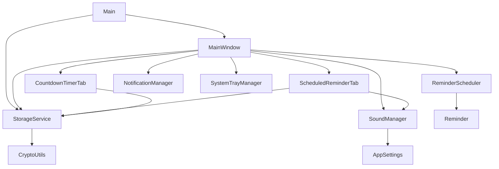
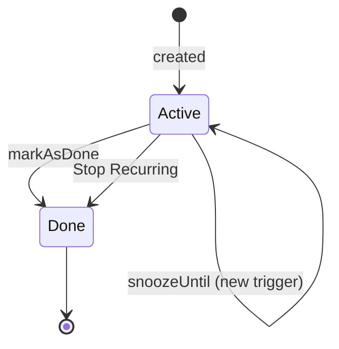
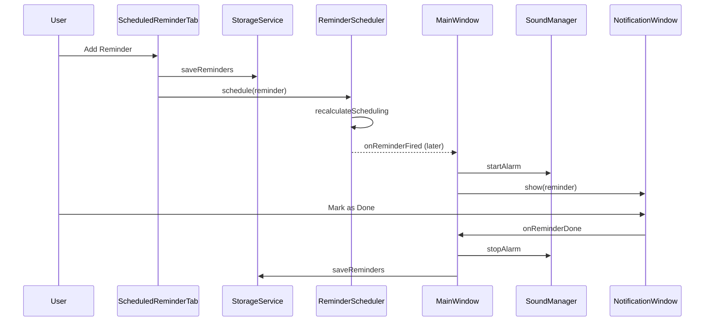
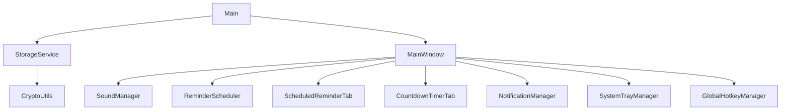
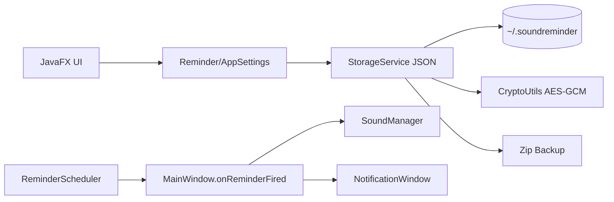
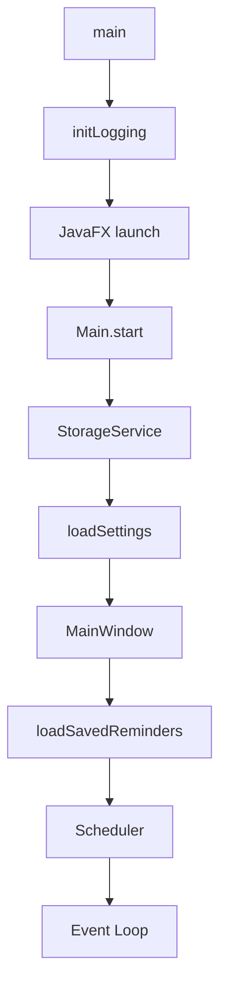

# SoundReminder — Forensic Architecture & Implementation Analysis

> Source of truth: the repository as of the analyzed commit. All statements below are grounded in repository evidence; unknowns are explicitly marked.

## 1. Executive Summary & System Boundaries

### 1.1 Project Purpose

SoundReminder is a single-process desktop alarm/reminder application built with Java 21 and JavaFX 21. It lets a user create scheduled reminders (specific date/time) and countdown timers (duration from now), attach optional images, play an alarm sound, show a top-right notification, and replay the alarm until acknowledged. Data persists as JSON under `~/.soundreminder/`, with optional AES-256-GCM encryption and zip backup import/export. A CI/CD pipeline and portable installer are included.

**Evidence:** `src/main/java/com/soundreminder/Main.java`; `src/main/java/com/soundreminder/ui/MainWindow.java`; `README.md`; `.github/workflows/*`; `build_installer.py`.

### 1.2 Target Actors

| Actor | Interaction | Implementation |
|---|---|---|
| End user | Creates/removes reminders, settings, themes, backups | JavaFX UI in `ui/*Tab.java`, `SettingsDialog.java` |
| JavaFX runtime | Window lifecycle, rendering | `Main extends Application`, `Platform.setImplicitExit(false)` |
| File system | JSON persistence, images, logs, backups | `storage/StorageService.java`, `Main.initLogging()` |
| Audio subsystem | Alarm playback | `sound/SoundManager.java` (Java Sound API) |
| OS system tray | Tray icon/menu/balloons | `ui/SystemTrayManager.java` (AWT `SystemTray`) |
| Scheduler thread pool | Timed firing | `scheduler/ReminderScheduler.java`, `MainWindow` executor |
| CI runner | Build/test/package | `.github/workflows/ci.yml`, `release.yml` |

### 1.3 System Boundaries

**Inside repository:** Java application module `com.soundreminder`, Gradle build, Python installer script, CSS/icon/sound resources, unit/integration tests, GitHub Actions workflows.

**Outside repository:** JDK 21 runtime, JavaFX SDK modules, OS audio/tray APIs, user home directory storage (`~/.soundreminder/`), optional custom sound files, attached image files copied into storage, GitHub-hosted runners.

### 1.4 Architectural Paradigm

Desktop monolith (single JVM process) with hand-wired layered structure: `model` → `storage`/`sound`/`scheduler`/`util` → `ui`. It is not a web app, service, or distributed system. Evidence: `application.mainClass = "com.soundreminder.Main"` in `build.gradle.kts`; no HTTP/server dependencies.

---

## 2. Repository Structure & File Organization

### 2.1 Root Directory

| Path | Type | Purpose | Evidence |
|---|---|---|---|
| `build.gradle.kts` | file | Gradle build, deps, JavaFX plugin, fatJar | shown |
| `settings.gradle.kts` | file | root project name | shown |
| `gradle.properties` | file | Gradle properties | present |
| `gradlew`, `gradlew.bat` | files | Gradle wrapper | present |
| `src/main/java` | dir | application source | listed |
| `src/main/resources` | dir | CSS, icons, sounds | listed |
| `src/test/java` | dir | JUnit tests | listed |
| `build_installer.py` | file | jpackage portable builder | shown |
| `generate_alarm_sound.py` | file | generates alarm WAV | present |
| `generate_tray_icon.py` | file | generates tray PNG | present |
| `README.md` | file | documentation | shown |
| `.github/workflows/ci.yml` | file | CI build/test | present |
| `.github/workflows/release.yml` | file | release packaging | present |
| `PROJECT_ARCHITECTURE.md` | file | architecture analysis | present |

### 2.2 Source Tree

| Package | Purpose | Depends On | Used By |
|---|---|---|---|
| `com.soundreminder` | entry point, logging | model, storage, ui | JVM |
| `com.soundreminder.model` | domain objects | Jackson | all |
| `com.soundreminder.storage` | JSON persistence, backup, encryption | model, Jackson, NIO, CryptoUtils | Main, ui |
| `com.soundreminder.sound` | audio playback | model, Java Sound | ui |
| `com.soundreminder.scheduler` | timed firing | model, executors | ui |
| `com.soundreminder.ui` | JavaFX UI, themes, notifications | model, storage, sound, scheduler | Main |
| `com.soundreminder.util` | NLP parser, sound generator, crypto | model | sound, storage, ui |

### 2.3 Dependency Management

Gradle 8.x wrapper, Java 21 toolchain. Key dependencies from `build.gradle.kts`:

- `com.fasterxml.jackson.core:jackson-databind:2.17.0`
- `com.fasterxml.jackson.datatype:jackson-datatype-jsr310:2.17.0`
- JavaFX 21.0.3 modules: base, graphics, controls, media, swing (classifier by OS)
- `org.junit.jupiter:junit-jupiter:5.10.2` (test)

Tests run with `--add-opens`/`--add-exports` for reflection. Fat JAR task `fatJar` bundles runtime classpath.

---

## 3. High-Level Architecture

### 3.1 Architecture Pattern

Manual constructor-based composition (no DI framework). UI components receive collaborators via constructors. Observed layers:

- `model`: passive data/serialization
- `storage`: persistence, encryption, backup
- `sound`: audio
- `scheduler`: timing
- `ui`: presentation + orchestration (MainWindow owns lifecycle)
- `util`: helpers (NLP, crypto, sound generation)

### 3.2 Component Map

| Component | Location | Responsibility | Depends On | Used By |
|---|---|---|---|---|
| Main | `com.soundreminder.Main` | logging, startup | StorageService, MainWindow | JVM |
| StorageService | `storage/StorageService.java` | JSON persistence, encryption, backup | model, Jackson, CryptoUtils | Main, ui |
| CryptoUtils | `util/CryptoUtils.java` | AES-256-GCM, PBKDF2 | javax.crypto | StorageService |
| SoundManager | `sound/SoundManager.java` | alarm playback | AppSettings, Java Sound | ui |
| ReminderScheduler | `scheduler/ReminderScheduler.java` | timed firing | model, executors | MainWindow |
| MainWindow | `ui/MainWindow.java` | orchestration, replay, themes | all | Main |
| ScheduledReminderTab | `ui/ScheduledReminderTab.java` | scheduled reminder CRUD, NLP quick-add, priority/recurrence | storage, sound, scheduler | MainWindow |
| CountdownTimerTab | `ui/CountdownTimerTab.java` | countdown CRUD, priority/recurrence | storage, sound, scheduler | MainWindow |
| NotificationWindow | `ui/NotificationWindow.java` | alarm popup | sound, storage | MainWindow |
| NotificationManager | `ui/NotificationManager.java` | notification abstraction | sound, storage | MainWindow |
| SystemTrayManager | `ui/SystemTrayManager.java` | tray icon | model, AWT | MainWindow |
| GlobalHotkeyManager | `ui/GlobalHotkeyManager.java` | hotkey scaffold | logging | MainWindow |
| NaturalLanguageParser | `util/NaturalLanguageParser.java` | NLP parsing | model | ScheduledReminderTab |

### 3.3 Dependency Direction



### 3.4 Architecture Implementation Evidence

**Manual composition in `MainWindow` constructor:**

```java
this.soundManager = new SoundManager(settings);
this.allReminders = new CopyOnWriteArrayList<>();
this.executorService = Executors.newScheduledThreadPool(4, r -> { ... });
this.scheduler = new ReminderScheduler(executorService, this::onReminderFired);
this.notificationManager = new NotificationManager(soundManager, storageService,
        this::onReminderDone, this::onSnoozeReminder);
```

File: `src/main/java/com/soundreminder/ui/MainWindow.java` (constructor).

---

## 4. Domain Model & Business Logic

### 4.1 Domain Concepts

- `Reminder` (entity, Serializable, Comparable): id, type, triggerTime, message, imagePath, active, done, recurrence, priority, tags, snooze fields.
- `ReminderType`: SCHEDULED, COUNTDOWN.
- `AppSettings`: customSoundPath, volume (clamped 0–1), encryptionEnabled, encryptionPassword, theme (DARK/LIGHT).
- `Priority`: LOW/NORMAL/HIGH/URGENT with rank; JSON via `@JsonValue`/`@JsonCreator`.
- `RecurrenceRule`: frequency, interval, daysOfWeek, dayOfMonth, description; computes next occurrence.
- `Tag`: name + colorHex (validated regex).
- `ParsedInput`: NLP parser output.
- `Theme`: DARK/LIGHT enum in AppSettings.

### 4.2 Entities

| Entity | File | Identity | Key Fields |
|---|---|---|---|
| Reminder | `model/Reminder.java` | UUID `id` | type, triggerTime, message, imagePath, active, done, recurrenceRule, priority, tags, snoozeCount |
| AppSettings | `model/AppSettings.java` | none (singleton-ish file) | customSoundPath, volume, encryptionEnabled, encryptionPassword, theme |

### 4.3 Business Rules

**Volume clamping:**

```java
public void setVolume(double volume) {
    this.volume = Math.max(0.0, Math.min(1.0, volume));
}
```
File: `src/main/java/com/soundreminder/model/AppSettings.java`.

**Color hex validation:**

```java
this.colorHex = (colorHex != null && colorHex.matches("^#[0-9A-Fa-f]{6}$"))
        ? colorHex : "#0078D4";
```
File: `src/main/java/com/soundreminder/model/Tag.java`.

**Reminder state transitions:**

```java
public void markAsDone() {
    this.done = true;
    this.active = false;
}
public void snoozeUntil(LocalDateTime newTime) {
    this.triggerTime = newTime;
    this.snoozeCount++;
    this.lastSnoozedAt = LocalDateTime.now();
    this.active = true;
    this.done = false;
}
```
File: `src/main/java/com/soundreminder/model/Reminder.java`.

**UI validation (scheduled):** message non-empty, date/time non-null, trigger in future. File: `ScheduledReminderTab.handleAddReminder()`.

**UI validation (countdown):** totalSeconds > 0 and message non-empty. File: `CountdownTimerTab.handleStartTimer()`.

**NLP integration:** `ScheduledReminderTab.handleQuickAdd()` uses `NaturalLanguageParser.parse()` to populate date/time, message, priority, recurrence. File: `src/main/java/com/soundreminder/ui/ScheduledReminderTab.java`.

### 4.4 State Transitions



Evidence: `Reminder.markAsDone`, `Reminder.snoozeUntil`, `NotificationWindow.handleDone/handleStopRecurring`.

### 4.5 Complex Algorithms

**Recurrence next occurrence (`RecurrenceRule.computeNextOccurrence`):** handles daily/weekly/monthly/yearly; weekly with named days uses `findNextDayOfWeek` scanning +1..+7 days; monthly clamps dayOfMonth to month length. File: `src/main/java/com/soundreminder/model/RecurrenceRule.java`.

**NLP parser (`NaturalLanguageParser.parse`):** regex-based extraction of priority, countdown shorthand, recurrence, absolute/relative/tomorrow/next-day times, then remaining text becomes message. File: `src/main/java/com/soundreminder/util/NaturalLanguageParser.java`.

**Alarm sound generation (`AlarmSoundGenerator.generateAlarmWav`):** two-tone 880/660 Hz sine wave with exponential envelope, written as 44.1kHz 16-bit mono WAV. File: `src/main/java/com/soundreminder/util/AlarmSoundGenerator.java`.

**AES-256-GCM (`CryptoUtils`):** 12-byte IV, 16-byte salt, PBKDF2WithHmacSHA256, 65536 iterations. File: `src/main/java/com/soundreminder/util/CryptoUtils.java`.

---

## 5. Persistence & Storage

### 5.1 Storage Technology

Jackson `ObjectMapper` with `JavaTimeModule`; file-based JSON; `ReentrantReadWriteLock`; atomic write via temp file + `Files.move(REPLACE_EXISTING)`; optional AES-256-GCM encryption; zip backup import/export.

### 5.2 Schema (JSON files)

| File | Content | Evidence |
|---|---|---|
| `~/.soundreminder/reminders.json` | `List<Reminder>` or encrypted base64 | `StorageService.remindersFile` |
| `~/.soundreminder/settings.json` | `AppSettings` | `StorageService.settingsFile` |
| `~/.soundreminder/images/` | copied image files | `imagesDir` |
| `~/.soundreminder/logs/` | dated log files | `Main.initLogging()` |

### 5.3 Data Access

Representative load/save fragments:

```java
public List<Reminder> loadReminders() {
    lock.readLock().lock();
    try {
        if (!Files.exists(remindersFile)) { return new ArrayList<>(); }
        // encrypted path if enabled
        ...
        List<Reminder> reminders = objectMapper.readValue(json, ...);
        return reminders;
    } catch (Exception e) {
        LOGGER.log(Level.SEVERE, "Failed to load reminders", e);
        return new ArrayList<>();
    } finally { lock.readLock().unlock(); }
}
```

```java
public void saveReminders(List<Reminder> reminders) {
    lock.writeLock().lock();
    try {
        // encrypt if enabled
        ...
        Path tempFile = remindersFile.resolveSibling("reminders.json.tmp");
        Files.writeString(tempFile, content);
        Files.move(tempFile, remindersFile, ...REPLACE_EXISTING);
    } catch (Exception e) { ... }
    finally { ... }
}
```
File: `src/main/java/com/soundreminder/storage/StorageService.java`.

Image copy resolves relative path:

```java
public String copyImageToStorage(Path sourcePath) throws IOException {
    Path sourceFileName = sourcePath.getFileName();
    if (sourceFileName == null) throw new IllegalArgumentException(...);
    String fileName = sourceFileName.toString();
    ...
}
```

Path safety:

```java
public Path resolveImagePath(String imagePath) {
    if (imagePath == null || imagePath.isBlank()) return null;
    if (imagePath.contains("\\") || imagePath.matches("^[a-zA-Z]:.*")) return null;
    Path path = Path.of(imagePath).normalize();
    if (path.isAbsolute()) return null;
    if (path.toString().contains("..")) return null;
    Path resolved = baseDir.resolve(path).normalize();
    if (!resolved.startsWith(baseDir)) return null;
    return resolved;
}
```

Backup:

```java
public void exportBackup(Path destinationZip) throws IOException { ... }
public void importBackup(Path sourceZip) throws IOException { ... }
```

### 5.4 Transactions

No database transactions. Concurrency is guarded by `ReentrantReadWriteLock` per `StorageService` instance. Evidence: `lock` field.

### 5.5 Migrations

No migration framework. `@JsonIgnoreProperties(ignoreUnknown = true)` on `Reminder` tolerates unknown fields. Evidence: `model/Reminder.java`.

### 5.6 Caching

No caching layer. Sound data is cached in `SoundManager.soundData` byte array after first load. Evidence: `sound/SoundManager.java`.

---

## 6. Application Layer & Backend

### 6.1 API Architecture

No network API (REST/GraphQL/gRPC/WebSocket) is present. The application is a desktop GUI; interactions are in-process JavaFX events and callbacks. Evidence: no server/controller annotations; dependencies contain no web framework.

### 6.2 Controllers / Handlers

UI event handlers act as entry points:

- `ScheduledReminderTab.handleAddReminder()` → validates → creates `Reminder` → `allReminders.add` → `storageService.saveReminders` → `scheduleCallback.accept`.
- `CountdownTimerTab.handleStartTimer()` similar.
- `NotificationWindow.handleDone/handleSnooze/handleStopRecurring`.
- `SettingsDialog.handleSave()` persists settings and applies theme.

### 6.3 Middleware / Filters / Interceptors

None present (no web pipeline).

### 6.4 Authentication / Authorization

Not applicable; single-user local app. No credentials, roles, or access checks. Evidence: no auth code.

### 6.5 Asynchronous Processing

- `ReminderScheduler` uses `ScheduledExecutorService` and `PriorityBlockingQueue<Reminder>`.
- `MainWindow.executorService`: `Executors.newScheduledThreadPool(4, daemon threads)`.
- `CountdownTimerTab.timerUpdateExecutor`: single-thread scheduled executor updating list every second.
- `SoundManager.testSound()` spawns a `SoundTestThread`.

Representative scheduling:

```java
scheduledFuture = executor.schedule(() -> {
    Reminder fired = reminderQueue.poll();
    if (fired != null && fired.isActive()) {
        onReminderFired.accept(fired);
        rescheduleIfRecurring(fired);
    }
    recalculateScheduling();
}, delayMillis, TimeUnit.MILLISECONDS);
```
File: `src/main/java/com/soundreminder/scheduler/ReminderScheduler.java`, `recalculateScheduling()`.

### 6.6 Error Handling

- `Main.start` catches `IOException` and generic `Exception`, shows JavaFX `Alert`, exits.
- `StorageService` catches `IOException`/`Exception`, logs, returns defaults/empty.
- UI handlers catch exceptions and show `Alert`.
- `SoundManager` catches audio exceptions and logs; `IllegalArgumentException` logged as WARNING for headless environments.

Logging: `java.util.logging` to console (WARNING+) and dated file (ALL). File: `Main.initLogging()`.

---

## 7. Frontend / Presentation Layer

### 7.1 Component Architecture

JavaFX, pure Java (no FXML). `MainWindow` builds `BorderPane` with toolbar + `TabPane`. Two tabs: `ScheduledReminderTab`, `CountdownTimerTab`. CSS from `/css/dark.css` or `/css/light.css` based on `AppSettings.Theme`.

### 7.2 State Management

- Shared `CopyOnWriteArrayList<Reminder> allReminders` passed to tabs.
- `SoundManager` holds settings reference.
- `volatile` fields in `MainWindow` for cross-thread visibility (`activeNotification`, `currentlyFiringReminder`, `replayCount`).
- No global store framework.

### 7.3 Routing

Not applicable; tab-based navigation via `TabPane`.

### 7.4 Data Fetching

No network. Data loaded from `StorageService` at startup (`loadSavedReminders`).

### 7.5 Styling

CSS resources `/css/styles.css`, `/css/dark.css`, `/css/light.css` applied to scenes. Theme switching at runtime via `MainWindow.applyTheme()` and `SettingsDialog`. Evidence: `applyTheme` method.

### 7.6 Performance

Only observable optimization: daemon thread pools, `CopyOnWriteArrayList`, atomic file writes. Countdown list refreshes every second.

---

## 8. Cross-Cutting Concerns

### 8.1 Design Patterns

| Pattern | Evidence | Location | Role |
|---|---|---|---|
| Manual DI (constructor injection) | constructors take collaborators | all components | wiring |
| Callback/observer | `Consumer<Reminder>`, `BiConsumer` | scheduler, MainWindow | firing events |
| Strategy (sound fallback) | custom → bundled → generated | `SoundManager.loadSoundData` | audio source selection |
| Thread-safe collection | `CopyOnWriteArrayList` | `MainWindow` | shared reminder list |
| Abstraction (notifications) | `NotificationManager` | `ui/NotificationManager.java` | notification creation |

### 8.2 Dependency Injection

No framework. `MainWindow` constructs `SoundManager`, executor, scheduler; tabs receive callbacks. Evidence: constructors shown.

### 8.3 Configuration

- `AppSettings` persisted JSON.
- Volume clamped in setter.
- Custom sound path string; if `"Default (bundled)"` UI maps to null.
- Theme enum (DARK/LIGHT) persisted.
- Encryption enabled/password persisted.
- No environment variables except `user.home`, `os.name`, `app.data.dir` (Android branch).
- Feature flags: none.

### 8.4 Security

- No authentication/authorization.
- Input validation for dates/times/messages.
- Path traversal protection in `resolveImagePath`.
- AES-256-GCM optional encryption via `CryptoUtils`.
- Atomic file writes.
- No SQL (no DB).
- No CSRF/CORS (no web).

### 8.5 Observability

`java.util.logging`: console handler WARNING+, file handler ALL with custom formatter including timestamp/level/logger/message. Evidence: `Main.initLogging()`.

### 8.6 Testing

JUnit 5. Test files:

| Test | Scope |
|---|---|
| `IntegrationTest` | end-to-end workflow without UI |
| `SchedulerTest` | scheduling, overdue, cancel, clear |
| `SoundManagerTest` | playback, fallback, volume, custom sound, headless |
| `StorageServiceTest` | persistence, images, settings, backup, path safety |
| `AppSettingsTest`, `ReminderTest`, `ReminderTypeTest` | model |
| `AlarmSoundGeneratorTest` | sound generation |
| `NaturalLanguageParserTest` | NLP parsing |
| `RecurrenceRuleTest` | recurrence calculations |
| `CryptoUtilsTest` | encryption round-trip |

Representative test fragment (overdue fires immediately):

```java
LocalDateTime pastTime = LocalDateTime.now().minusMinutes(5);
Reminder reminder = new Reminder(ReminderType.SCHEDULED, pastTime, "Overdue reminder", null);
testScheduler.schedule(reminder);
boolean fired = latch.await(3, TimeUnit.SECONDS);
assertTrue(fired);
```
File: `src/test/java/com/soundreminder/scheduler/SchedulerTest.java`.

---

## 9. Critical Execution Flows

### 9.1 Flow: Add Scheduled Reminder and Fire

**Overview:** User creates a scheduled reminder; it is persisted, scheduled, fires at trigger time, shows notification and alarm, replay cycle runs until acknowledged.

**Steps:**

1. `ScheduledReminderTab.handleAddReminder()` validates input.
2. Creates `Reminder(ReminderType.SCHEDULED, triggerTime, message, imagePath, recurrence, priority, tags)`.
3. `allReminders.add(reminder)`; `storageService.saveReminders(allReminders)`.
4. `scheduleCallback.accept(reminder)` → `MainWindow.scheduler.schedule(reminder)`.
5. `ReminderScheduler.schedule` adds to `PriorityBlockingQueue`, calls `recalculateScheduling`.
6. Executor schedules task for delay; on fire, polls queue, calls `onReminderFired` (MainWindow).
7. `MainWindow.onReminderFired` (on JavaFX thread) starts sound, shows `NotificationWindow`, schedules replay.
8. On acknowledge: `onReminderDone` marks done, cancels scheduler, saves, refreshes UI.

**Evidence fragment (MainWindow onReminderFired):**

```java
private void onReminderFired(Reminder reminder) {
    Platform.runLater(() -> {
        if (activeNotification != null && activeNotification.isShowing()) {
            activeNotification.hide();
        }
        this.currentlyFiringReminder = reminder;
        this.replayCount = 0;
        soundManager.startAlarm();
        activeNotification = notificationManager.createNotificationWindow();
        activeNotification.show(reminder);
        scheduleReplay(reminder);
    });
}
```

**Sequence diagram:**



**Edge cases:** past time rejected in UI; overdue reminders on startup are staggered 1 second apart (`loadSavedReminders`); inactive reminders ignored by scheduler; headless audio suppressed.

### 9.2 Flow: Countdown Timer

1. `CountdownTimerTab.handleStartTimer` computes `triggerTime = now + duration`, creates `ReminderType.COUNTDOWN`.
2. Persist + schedule.
3. Timer list refreshes every second showing remaining time.
4. Fires like scheduled reminder.

### 9.3 Flow: Replay Cycle

`MainWindow.scheduleReplay` schedules: after 60s stop sound if notification not showing? Updated to unconditionally stop after 60s and restart after 5 minutes (300s); repeats. Evidence: `REPLAY_DELAY_SECONDS = 60`, `REPLAY_INTERVAL_SECONDS = 300`.

---

## 10. Infrastructure, DevOps & Deployment

### 10.1 Docker

Not present (no Dockerfile).

### 10.2 Docker Compose

Not present.

### 10.3 CI/CD

GitHub Actions workflows:

- `.github/workflows/ci.yml`: triggers on push/PR to main/master; matrix ubuntu/windows; JDK 21 Temurin; Gradle cache; `./gradlew test`, `./gradlew build fatJar`; upload test reports on failure.
- `.github/workflows/release.yml`: triggers on `v*` tags; runs `build_installer.py`; uploads `build/installer/` to release.

### 10.4 Kubernetes

Not present.

### 10.5 Infrastructure as Code / Installer

`build_installer.py` uses Gradle `fatJar` then `jpackage` to create a portable app image under `build/installer/SoundReminder/`. It searches for `jpackage` via `JAVA_HOME`/`shutil.which`. Evidence: script.

---

## 11. Code-Level Implementation Catalog

### Scheduling Mechanism
- **Purpose:** precise timed firing of earliest reminder.
- **Location:** `src/main/java/com/soundreminder/scheduler/ReminderScheduler.java`
- **Symbols:** `schedule`, `cancel`, `reSchedule`, `clear`, `checkOverdueReminders` (deprecated), `recalculateScheduling`, `rescheduleIfRecurring`
- **Dependencies:** `ScheduledExecutorService`, `PriorityBlockingQueue`, `Reminder`
- **Consumers:** `MainWindow`

### Persistence Mechanism
- **Purpose:** atomic JSON save/load, optional encryption, backup.
- **Location:** `src/main/java/com/soundreminder/storage/StorageService.java`
- **Symbols:** `loadReminders`, `saveReminders`, `loadSettings`, `saveSettings`, `copyImageToStorage`, `resolveImagePath`, `exportBackup`, `importBackup`
- **Source:** section 5.3.

### Sound Playback
- **Purpose:** looped alarm with volume and headless fallback.
- **Location:** `src/main/java/com/soundreminder/sound/SoundManager.java`
- **Symbols:** `startAlarm`, `stopAlarm`, `isPlaying`, `isAudioSupported`, `loadSoundData`, `setClipVolume`, `testSound`
- **Source fragment:**

```java
public void startAlarm() {
    stopAlarm();
    alarmActive = true;
    try {
        if (soundData == null) { soundData = loadSoundData(); }
        if (soundData == null) { alarmActive = false; return; }
        try (java.io.InputStream bais = new java.io.ByteArrayInputStream(soundData);
             AudioInputStream ais = AudioSystem.getAudioInputStream(bais)) {
            Clip clip = AudioSystem.getClip();
            clip.open(ais);
            setClipVolume(clip, settings.getVolume());
            clip.loop(Clip.LOOP_CONTINUOUSLY);
            activeClip = clip;
        }
        LOGGER.info("Alarm started, volume: " + settings.getVolume());
    } catch (LineUnavailableException | IOException | UnsupportedAudioFileException | IllegalArgumentException e) {
        if (e instanceof IllegalArgumentException) {
            LOGGER.log(Level.WARNING, "Audio line unsupported or headless environment detected, suppressing audio playback.");
        } else {
            alarmActive = false;
            LOGGER.log(Level.SEVERE, "Failed to start alarm", e);
        }
    }
}
```

### Replay Logic
- **Purpose:** auto-stop after 60s, restart after 5 min until done.
- **Location:** `MainWindow.scheduleReplay`
- **Source:** see 9.3.

### NLP Parser
- **Purpose:** parse free-text reminder input.
- **Location:** `src/main/java/com/soundreminder/util/NaturalLanguageParser.java`
- **Symbols:** `parse`, `extractPriority`, `tryParseCountdownShorthand`, `extractCountdown`, `extractRecurrence`, `extractAbsoluteDateTime`, etc.
- **Status:** wired into `ScheduledReminderTab.handleQuickAdd()`.

### Recurrence Calculation
- **Purpose:** compute next trigger for recurring reminders.
- **Location:** `RecurrenceRule.computeNextOccurrence`
- **Source:** section 4.5.

### Image Storage
- **Purpose:** copy + relative path resolution with traversal protection.
- **Location:** `StorageService.copyImageToStorage`, `resolveImagePath`.

### System Tray
- **Purpose:** tray icon, menu, balloons.
- **Location:** `SystemTrayManager`.

### Logging
- **Purpose:** console + file logging.
- **Location:** `Main.initLogging`.

### Encryption
- **Purpose:** optional AES-256-GCM encryption of reminders.
- **Location:** `CryptoUtils`, `StorageService`.

### Backup
- **Purpose:** zip export/import with rollback.
- **Location:** `StorageService.exportBackup`, `importBackup`.

### Theming
- **Purpose:** dark/light CSS switching.
- **Location:** `AppSettings.Theme`, `MainWindow.applyTheme`, `SettingsDialog`.

---

## 12. Important Classes & Functions

| Symbol | File | Responsibility | Importance |
|---|---|---|---|
| `Main.main/start/stop/initLogging` | `Main.java` | entry, logging, startup | High |
| `StorageService` (all) | `StorageService.java` | persistence, encryption, backup | High |
| `CryptoUtils` (all) | `CryptoUtils.java` | AES-GCM, PBKDF2 | High |
| `SoundManager` (all) | `SoundManager.java` | audio, headless fallback | High |
| `ReminderScheduler` (all) | `ReminderScheduler.java` | timing | High |
| `MainWindow` (constructor, onReminderFired, scheduleReplay, onReminderDone, cleanup, applyTheme) | `MainWindow.java` | orchestration | High |
| `ScheduledReminderTab.handleAddReminder/handleQuickAdd` | `ScheduledReminderTab.java` | create scheduled, NLP | High |
| `CountdownTimerTab.handleStartTimer` | `CountdownTimerTab.java` | create countdown | High |
| `NotificationWindow.show/handleDone/handleSnooze` | `NotificationWindow.java` | alarm popup | High |
| `NotificationManager` | `NotificationManager.java` | notification abstraction | Medium |
| `NaturalLanguageParser.parse` | `NaturalLanguageParser.java` | NLP | Medium |
| `RecurrenceRule.computeNextOccurrence` | `RecurrenceRule.java` | recurrence | Medium |
| `AlarmSoundGenerator.generateAlarmWav` | `AlarmSoundGenerator.java` | sound gen | Medium |
| `SystemTrayManager` | `SystemTrayManager.java` | tray | Medium |
| `GlobalHotkeyManager` | `GlobalHotkeyManager.java` | hotkey scaffold | Low |

---

## 13. Configuration & Runtime Behavior

**Startup sequence:**

1. `Main.main` calls `initLogging()` (creates `~/.soundreminder/logs/`, adds handlers).
2. `launch(args)` → JavaFX calls `Main.start(primaryStage)`.
3. `Platform.setImplicitExit(false)`.
4. `new StorageService()` creates `~/.soundreminder/` + `images/`, configures Jackson.
5. `storageService.loadSettings()` (defaults if missing).
6. `new MainWindow(primaryStage, storageService, settings)`:
   - constructs SoundManager, CopyOnWriteArrayList, executor, scheduler, NotificationManager
   - `buildMainWindow()` builds UI, sets close handler, applies theme
   - `loadSavedReminders()` loads JSON, schedules future, staggers overdue
   - configures stage, `stage.show()`
   - creates SystemTrayManager
7. App runs; daemon worker threads handle scheduling.

**Shutdown:** close handler minimizes to tray if supported; otherwise `cleanup()` saves reminders, stops sound, shuts down executors, removes tray.

Evidence: `Main.start`, `MainWindow` constructor, `cleanup`.

---

## 14. Empirical Observations & Codebase Quirks

### 14.1 Idiosyncrasies
- Pure Java JavaFX (no FXML); all UI built programmatically.
- Android branch in `StorageService` (`os.name` contains "android") but GluonFX plugin commented out in build.
- `Reminder` has `serialVersionUID = 2L` and implements `Serializable` but storage uses JSON, not Java serialization.
- Global hotkey is a scaffold (no native OS hook implementation).

### 14.2 Technical Debt
- `Tag` model exists but no UI for tags.
- `scheduleReplay` logic updated but original condition was inverted.
- `ReminderScheduler.checkOverdueReminders()` deprecated; overdue handling in `MainWindow.loadSavedReminders()`.
- README previously claimed 65 tests; corrected.
- Light/dark CSS currently identical copies (light theme not fully differentiated).
- `SettingsDialog` theme combo added; light theme visuals minimal.

### 14.3 Strengths
- Thread-safe shared list (`CopyOnWriteArrayList`).
- Atomic file writes (temp + rename).
- Read/write locks for storage.
- Overdue reminders staggered to avoid UI flooding.
- Sound fallback chain (custom → bundled → generated) and headless fallback.
- Path traversal protection.
- Optional encryption and backup.
- Unit/integration tests covering scheduler, sound, storage, parser, recurrence, crypto.

### 14.4 Contradictions
- README "Top-Left Notification" corrected to top-right.
- README replay description aligned with implementation.

---

## 15. Architecture Decision Evidence

| Decision/Property | Evidence | Confidence |
|---|---|---|
| Desktop monolith | `Main extends Application`, no web deps | High |
| File-based JSON persistence | `StorageService` | High |
| Manual DI | constructors | High |
| JavaFX UI | build javafx plugin, `ui/*` | High |
| Thread pool scheduling | `ReminderScheduler`, executors | High |
| No authentication | no auth code | High |
| Optional encryption | `CryptoUtils`, AppSettings | High |
| Backup/restore | `StorageService.exportBackup/importBackup` | High |
| Theme switching | `AppSettings.Theme`, applyTheme | High |
| CI/CD | `.github/workflows` | High |
| Recurring model used in UI | Scheduled/Countdown tabs | High |
| NLP parser used in UI | ScheduledReminderTab.handleQuickAdd | High |

---

## 16. Final System Model

### Component Graph



### Data Flow



### Runtime Flow



### Technology Matrix

| Area | Technology | Evidence |
|---|---|---|
| Language | Java 21 | build.gradle.kts |
| Framework | JavaFX 21 | javafx plugin/deps |
| Build | Gradle 8 | wrapper |
| Persistence | Jackson JSON | StorageService |
| Encryption | AES-256-GCM, PBKDF2 | CryptoUtils |
| Audio | Java Sound API | SoundManager |
| Concurrency | ScheduledExecutorService, PriorityBlockingQueue | scheduler |
| Testing | JUnit 5 | build.gradle.kts |
| Containerization | None | no Dockerfile |
| CI/CD | GitHub Actions | .github/workflows |
| Installer | jpackage via Python | build_installer.py |

---

## 17. Missing / Unavailable Information

- Production runtime environment and performance characteristics cannot be determined statically.
- Light theme not fully differentiated from dark theme.
- Native global hotkey not implemented (scaffold only).
- Android build path is scaffolded but disabled (GluonFX plugin commented out); runtime behavior on Android unverified.
- Test execution results not included in repository (no reports).
- No license file? README says MIT badge but no LICENSE file observed.
